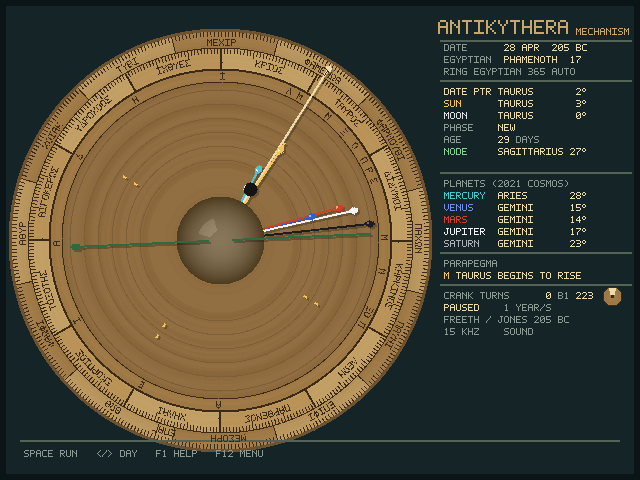

# Antikythera Mechanism for MiSTer

Turn the crank of the ancient Greek astronomical calculator and watch the Sun,
Moon and planets move through the zodiac, the Egyptian calendar turn, the
19-year Metonic calendar and the Games dial count the years, and the Saros
dial predict eclipses. Every pointer is driven by the surviving tooth counts,
so what you see is what the bronze gears computed.

## Install

1. [Download the core](releases/Antikythera_20261012.rbf?raw=true).
2. Copy the `.rbf` file to `_Computer/` on your MiSTer's SD card.
3. Launch **Antikythera** from MiSTer's Computer menu.

No ROMs or SDRAM module are needed. The picture is 640×480, sent as 15 kHz
interlaced video for TVs and direct video, or as 31 kHz progressive video
when your `MiSTer.ini` has `forced_scandoubler=1` (or you pick it in the
menu). HDMI works either way.

## Controls

| Key | Action |
| --- | --- |
| Space | Run / pause |
| Left / Right | One day back / forward (hold to keep turning) |
| Down / Up | One lunar month back / forward |
| Page Down / Page Up | One year back / forward |
| - / + | Slower / faster (one day to a century per second) |
| R | Reverse direction |
| Tab, 1, 2, 3 | Front dial, back dials, gear train |
| [ ] | Turn the calendar ring by one day |
| Home | Return to the epoch |
| F1 | Help |
| F12 | MiSTer menu |

Gamepad: A and B crank, X runs and pauses, Y changes the view, the shoulder
buttons change speed, Start opens help and Select reverses.

The instrument makes a sound: a click for every tooth of the crank wheel
that passes while it runs, a tick for each turn by hand, and a two-note
chime when the Saros pointer reaches an eclipse (lower for a lunar eclipse,
higher for a solar one). Turn it off in the menu if you prefer.

## Reading the dials

**Front.** The outer ring is the Egyptian calendar; the long pointer is the
date and mean Sun. Inside it the zodiac, with the parapegma index letters
that key the star-rising calendar. The golden sphere is the true Sun, the
black-and-white ball on the silver arm is the Moon and shows its phase, and
the five stones are the planets on the rings of the 2021 Cosmos
reconstruction. The green hand is the Dragon Hand: its head marks the
ascending node, and when the Sun is near either end an eclipse season is
underway. The panel on the right spells everything out.

**Back.** The upper spiral is the 235-month Metonic calendar with its
Corinthian month names; the two small dials inside it are the 76-year
Callippic cycle and the four-year Games cycle (Olympia, Isthmia, Nemea,
Pythia, Naa and Halieia). The lower spiral is the 223-month Saros dial. Cells
with a silver outer half carry a lunar eclipse glyph (Σ), a gold inner half a
solar one (Η); the small dial inside is the Exeligmos, which adds 0, 8 or 16
hours to the inscribed times. The readout shows this month's glyph and the
next eclipse.

**Gear train.** Every surviving wheel, named as in the literature, rotating
at its true rate. The large wheels are outlines so the ones behind them stay
visible.

## Things to try

1. Press **Space**. A year passes every second: the date pointer sweeps the
   zodiac, the Moon races round it and its phase ball turns.
2. Press **2** for the back. Watch the Metonic pointer slide outward along
   its spiral and the Games pointer step through the four-year cycle.
3. Press **Space** to pause, then **Up** repeatedly. Each press is one lunar
   month: the Saros pointer moves one cell and the readout names the eclipse
   when it lands on a glyph.
4. Press **Home** and **1**. On 28 April 205 BC the Sun and Moon stand
   together in Taurus, the New Moon from which the Saros dial was designed.

Press **F12** to choose the 178 BC calibration proposed by Voulgaris et al.
instead, a 354-hole lunar calendar ring, a 224-tooth b1, or to hide the
planets and keep only the Sun, Moon and date that survive in the fragments.
The same menu has the scan rate (follow `MiSTer.ini`, 15 kHz interlaced or
31 kHz progressive), the HDMI deinterlacer (weave or bob), the aspect ratio,
integer scaling and sound.

## Gotchas

- **The Mechanism's own readings are shown, not a modern ephemeris.** Planets
  can be a few degrees off, as the Greek theories were.
- Hours labelled RECONSTRUCTED on the Saros readout are computed, not
  inscribed on the fragments.
- Turning the calendar ring with [ and ] switches it to manual; the menu's
  ring registration setting puts it back on automatic.
- **15 kHz output is interlaced (480i).** Thin lines shimmer a little on a
  CRT, as they do for any 480-line picture; set `forced_scandoubler=1` in
  `MiSTer.ini` for a 31 kHz monitor, or choose 31 kHz in the menu.

What the core is based on, and where it fills gaps, is in
[docs/research.md](docs/research.md). Build and test notes are in
[docs/development.md](docs/development.md).
